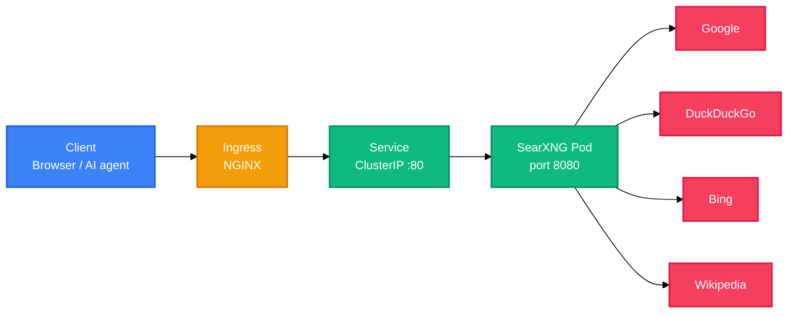

<h1 align="center">SearXNG</h1>

<p align="center">
  <strong>Self-hosted SearXNG meta-search instance deployed on Kubernetes</strong>
  <br />
  <em>Private search · JSON API for AI agents · Kubernetes & NGINX ingress</em>
</p>

<p align="center">
  <a href="#quick-start"></a>
  <a href="LICENSE"></a>
</p>

<p align="center">
  <a href="https://docs.anthropic.com/en/docs/claude-code"></a>
  <a href="https://docs.anthropic.com/en/docs/claude-code"></a>
  <a href="https://docs.anthropic.com/en/docs/claude-code"></a>
  <a href="https://docs.anthropic.com/en/docs/claude-code"></a>
</p>

This repository contains the configuration and Kubernetes manifests for a self-hosted SearXNG instance. It runs the official `searxng/searxng` container with runtime settings delivered via a ConfigMap and is exposed both internally and on the public internet.

## Features

| Feature | Description |
|---|---|
| Private meta-search | Aggregates results from Google, DuckDuckGo, Bing, and Wikipedia in one place |
| JSON API for AI agents | The `json` output format is enabled so agents can query the API without 403 responses |
| Kubernetes-native | Single manifest bundles a Deployment, ClusterIP Service, and internal Ingress |
| Internal and public access | Reachable at an internal hostname and via a public NGINX ingress |
| Image proxy | SearXNG's image proxy is enabled to shield client IPs when loading result thumbnails |
| Zero-code config | Runtime behavior is controlled entirely by one YAML file and a few environment variables |

## Quick Start

### Prerequisites

- A Kubernetes cluster with an NGINX ingress controller
- `kubectl` configured for the target cluster
- ConfigMap must be applied before the Deployment (it mounts the config)

### Deploy

```bash
kubectl apply -f k8s/searxng-configmap.yaml
kubectl apply -f k8s/searxng-deployment.yaml
kubectl apply -f k8s/searxng-secret.yaml
kubectl apply -f k8s/searxng-external-ingress.yaml
```

ConfigMap must be applied before the Deployment. To update settings, edit `k8s/searxng-configmap.yaml` and reapply; the pod must be restarted for changes to take effect.

## Usage

### Web Search

Open the internal hostname (`searxng.localhost`) or the public hostname in a browser and type a query.

### JSON API

```bash
curl "http://searxng.localhost/search?q=hello+world&format=json"
```

Returns results as JSON, suitable for AI agents and scripts.

### Health Check

```bash
curl "http://searxng.localhost/healthz"
```

Used by the liveness and readiness probes to determine pod health.

## Architecture



Requests enter through NGINX, route through the ClusterIP Service to the SearXNG pod, and fan out to the upstream search engines.

## Configuration

### ConfigMap (`k8s/searxng-configmap.yaml`)

Delivered to the pod via a ConfigMap volume mount.

| Key | Value | Notes |
|---|---|---|
| `server.image_proxy` | `true` | Proxies result images |
| `server.method` | `GET` | HTTP method used for searches |
| `server.limiter` | `false` | Rate limiter disabled |
| `search.safe_search` | `0` | Safe search disabled |
| `search.formats` | `html, json` | JSON must stay enabled for API access |
| `engines` | google, duckduckgo, bing, qwant, wikipedia, github, arxiv, google news | All enabled |
| `preferences.lock` | categories, language, locale, autocomplete, image_proxy, method, safesearch | User preferences locked |

### Environment Variables

| Variable | Description |
|---|---|
| `SEARXNG_SECRET` | Signing secret for sessions and JSON output (masked) |
| `SEARXNG_BASE_URL` | Public base URL of the instance (masked) |
| `TZ` | `Asia/Hong_Kong` — container timezone |

## API

| Method | Path | Description |
|---|---|---|
| GET | `/` | Search UI |
| GET | `/search?q=QUERY` | HTML results page |
| GET | `/search?q=QUERY&format=json` | JSON results (for AI agents and scripts) |
| GET | `/healthz` | Liveness / readiness probe endpoint |

## Project Structure

```
k8s/
├── searxng-configmap.yaml          # ConfigMap with settings.yml + limiter.toml
├── searxng-deployment.yaml         # Deployment + ClusterIP Service + internal Ingress
├── searxng-secret.yaml             # Secret with SEARXNG_SECRET (gitignored)
└── searxng-external-ingress.yaml   # Public Ingress (gitignored)
AGENTS.md                           # Agent instructions for this repo
LICENSE
```

## Tech Stack

| Layer | Technology | Purpose |
|---|---|---|
| Runtime | SearXNG | Meta-search engine (official image) |
| Orchestration | Kubernetes | Deployment, Service, Ingress resources |
| Ingress | NGINX | Internal and public routing |
| Storage | ConfigMap volume | `settings.yml` + `limiter.toml` mounted at `/etc/searxng` |
| Configuration | YAML + env vars | Runtime behavior without code changes |

## Deployment

### Kubernetes

```bash
kubectl apply -f k8s/searxng-configmap.yaml
kubectl apply -f k8s/searxng-deployment.yaml
kubectl apply -f k8s/searxng-secret.yaml
kubectl apply -f k8s/searxng-external-ingress.yaml
```

The Deployment runs a single replica of `searxng/searxng:latest` on port 8080 with CPU and memory limits, plus liveness and readiness probes on `/healthz`. Config is delivered via ConfigMap; restart the pod to pick up changes.

## Contributing

1. Fork the repository
2. Create a feature branch (`git checkout -b feature/change`)
3. Commit your changes (`git commit -m 'feat: add change'`)
4. Push to the branch (`git push origin feature/change`)
5. Open a Pull Request

Contributor history unavailable (no git metadata access).

## License

[MIT](LICENSE)

<!-- BEAUTIFIED -->
